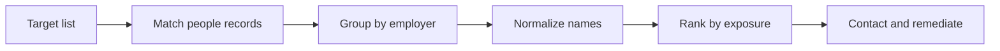

## Introduction

By providing a commercially-available database of personally-identifiable information (PII), Datafiniti's People Data can be used to protect companies against potential cyberattacks.  Let's learn how!

## What you get

Match a target list against People Data and every person comes back as one row of people schema fields, with the employer sitting in `businessName`. Group enough of those rows by employer and a flat list of individuals becomes something a security team can act on: a ranked list of companies, each with the named people and the roles behind it.

In practice, a remediated target list answers three questions in order. Which companies are affected, how badly, and who inside them should be contacted first.

This page covers the company-level work: resolving matches to employers, cleaning up employer names, ranking the result, and estimating how large a company's exposure really is. The per-person mechanics, including how a single record is matched and enriched, are on [Identifying employees targeted by cyberattacks](/docs/identifying-employees-targeted-by-cyberattacks).



## Searching against a known target list

If your company provides cybersecurity protection, you likely have access to lists of known compromised individuals  These lists will likely contain name, email, and other identifiers for each person.  A list may look like:

```csv
Name, Email
Joe Curry, joe.curry@bellideas.com
Tina Harris, tharris@gmail.com
Luis Fiego, luis42@plymouth.edu
```

You can take information like this and use it to find matching individuals in our people database.  Here's how such a search might look:

```json
{
  "query": "firstName:\"Joe\" AND lastName:\"Curry\" AND emails:\"joe.curry@bellideas.com\""
}
```

If a matching record comes back, it will include the company that currently employs the individual.

```json
"businessName": "bell ideas",
```

### The fields behind the answer

A match returns a full people record, not just an employer name. These are the fields that turn a single match into a ranking input.

<ParamField body="businessName" param-type="string" show-location="false">The current business where the person works. This is the field you group by.</ParamField>
<ParamField body="businessCategories" param-type="array" show-location="false">The employer's industry, as one or more category strings. Use it to weight how sensitive the company's sector is.</ParamField>
<ParamField body="numEmployeesMin" param-type="integer" show-location="false">Lower bound of the employer's employee count. Read it together with `numEmployeesMax` to gauge company size.</ParamField>
<ParamField body="numEmployeesMax" param-type="integer" show-location="false">Upper bound of the employer's employee count.</ParamField>
<ParamField body="jobLevel" param-type="string" show-location="false">Seniority of the person at that employer, such as `cxo`, `director`, or `entry`.</ParamField>
<ParamField body="jobTitle" param-type="string" show-location="false">Free-text title for the person, useful for naming the account in an outreach message.</ParamField>
<ParamField body="jobFunction" param-type="string" show-location="false">The person's current job function, such as `engineering`, `finance`, `legal`, or `sales`, which tells you whether the compromised account reaches code, money, or customer data.</ParamField>
<ParamField body="dateUpdated" param-type="string" show-location="false">When the record was last updated, which tells you how much to trust the match.</ParamField>

The full field list is on [People Data Schema](/docs/people-data-schema). The allowed values for `businessCategories` and `jobLevel` are on [Possible Values for People Fields](/docs/possible-values-for-people-fields).

<Callout kind="alert">

A people-data match is commercially sourced PII and a strong indicator, not proof of current employment. Confirm the company through `dateUpdated` and a second identifier, such as a work email domain or a phone number, before you contact anyone about an account.

</Callout>

### Resolving a whole target list in one request

Target lists arrive by the hundred, so combine several people into a single query with `OR` instead of sending one call per row.

```json
{
  "query": "(firstName:\"Joe\" AND lastName:\"Curry\" AND emails:\"joe.curry@bellideas.com\") OR (firstName:\"Tina\" AND lastName:\"Harris\" AND emails:\"tharris@gmail.com\") OR (firstName:\"Luis\" AND lastName:\"Fiego\" AND emails:\"luis42@plymouth.edu\")"
}
```

The response contains one record per person that matched, each with its own `businessName`, `jobLevel`, and `dateUpdated`. People who did not match are simply absent from the results, so compare the returned `emails` values against your input file to see who is unresolved and needs a second query on a different identifier, such as a phone number or a name plus city.

## Aggregating data to identify compromised companies

As you match each person and find their current company, you can append the data to your original file:

```csv
Name, Email, Company
Joe Curry, joe.curry@bellideas.com, bell ideas
Tina Harris, tharris@gmail.com, quickpro
Luis Fiego, luis42@plymouth.edu, plymouth university
```

Once you've done so, you can count up the companies in your updated list to find which companies may be compromised more severely than others.

That count is the simplest possible ranking: whichever company appears most often sits at the top. It is a good starting point, but it treats every row as equally important and every spelling of a company name as a separate company. The next two sections fix both problems.

## Grouping and normalizing employers before you rank them

`businessName` is free text recorded as it appeared on the source profile, so the same employer arrives in several shapes. A single company can appear as `universal lumpers inc.`, `Bell Ideas`, and `bell ideas` in the same result set. Count those rows without cleaning them and one company splits into three weak entries that never reach the top of the list.

| Raw `businessName` | Normalized key | What changed |
|---|---|---|
| `universal lumpers inc.` | universal lumpers | Legal suffix removed |
| `Bell Ideas` | bell ideas | Case folded and trimmed |
| `bell ideas` | bell ideas | Already clean |

Normalize before you count: trim whitespace, fold case, strip trailing legal suffixes such as `inc.`, `llc`, `ltd.`, `corp.`, and `co.`, and match on the distinctive root of the name rather than the full string. Keep the raw value alongside the normalized key so you can show the reader exactly what the record said.

Name collisions need a second check. Two unrelated companies can share a name, so when a `businessName` match looks suspicious, use `businessCategories` to compare industries, `province` to compare location, and `numEmployeesMin` and `numEmployeesMax` to compare size. A ten-person `bell ideas` in one province and a four-hundred-person `bell ideas` in another are different employers, and merging them produces a company that does not exist.

Old records are the other trap. If a person's `businessName` looks stale, check their `experiences` list, which can show the previous employer and when that role ended. `dateUpdated` tells you how recently the record itself was seen, so a row updated years ago is a weaker signal than one updated recently, and you should decide whether to trust it before it contributes to a ranking.

## Ranking which companies to approach first

Rank on a small number of factors you can defend in a remediation meeting rather than on a single score nobody can explain. Each factor below comes from a named field, so every position on the list can be traced back to a record.

- **How many people from your list map to the company**: a count of matched rows grouped by your normalized `businessName` key. More named people at one employer means more accounts to reset and a wider blast radius.
- **How sensitive the industry is**: `businessCategories`. Categories such as `computer & network security`, `information technology and services`, `financial services`, `banking`, `insurance`, `hospital & health care`, and `legal services` carry regulatory or downstream risk that a generic employer does not. The allowed values are listed on [Possible Values for People Fields](/docs/possible-values-for-people-fields).
- **How senior those people are**: `jobLevel` values `cxo`, `vp`, `director`, `manager`, `owner`, and `partner` carry more weight than `senior`, `entry`, `training`, and `unpaid`. `jobFunction` separates an engineering or finance account from a generic one, which tells you whether the compromised login could reach code or money.
- **How large the employer is**: `numEmployeesMin` and `numEmployeesMax`. A single compromised account at a large employer can expose many downstream accounts, so size magnifies every other factor.
- **How fresh the match is**: `dateUpdated`. A recent record is more likely to reflect the person's current role, and a stale one is worth a verification step before you include it.

A simple triage order falls out of this. Many senior people at a sensitive industry goes first, a moderate cluster at a large employer goes next, and a single old record at an unrelated small business goes last.

When you reach out, give the top-ranked companies a specific ask rather than a generic alert. Name the accounts that matched, ask the company to reset those accounts, then ask it to review access for the roles you identified through `jobLevel` and `jobFunction`.

## Estimating exposure per company with count queries

A match count of six means very different things at a ten-person shop and a ten-thousand-person enterprise. Count the company's reachable employees to read your match count as a proportion rather than a bare number.

```json
{
  "query": "businessName:\"bell ideas\" AND professionalEmails:*",
  "num_records": 0
}
```

Setting `num_records` to `0` returns the total number of matching records without downloading any of them, which makes this cheap enough to run per company in a ranking pass. The same filter with `jobLevel:cxo` counts executive accounts specifically.

```json
{
  "query": "businessName:\"bell ideas\" AND jobLevel:cxo AND professionalEmails:*",
  "num_records": 0
}
```

Six matched people out of forty reachable employees is a materially different finding from six out of four thousand, and the executive count tells you whether the compromised accounts sit near decision-making. How counts are billed and how `num_records` behaves is documented on [Count](/docs/people-count).

## Running this at scale

For target lists in the hundreds or thousands, automate the resolve-then-aggregate loop through the API rather than working row by row in the portal. The loop is the same one you ran by hand: send a batch query, collect `businessName` and the other ranking fields from each returned record, fill a company column, and compute the ranking from that file.

- [People API Features](/docs/people-api-features) covers bulk downloads, formats, and the request options available on people queries.
- [Constructing People Queries](/docs/constructing-people-queries) covers combining conditions with `AND` and `OR` so a whole batch resolves in one call.
- [People Data with Python](/docs/people-data-with-python) walks through scripting the loop end to end.

A download request returns the same fields in a portable file:

```json
{
  "query": "(firstName:\"Joe\" AND lastName:\"Curry\" AND emails:\"joe.curry@bellideas.com\") OR (firstName:\"Tina\" AND lastName:\"Harris\" AND emails:\"tharris@gmail.com\")",
  "download": true,
  "format": "CSV",
  "num_records": 2
}
```

A CSV download puts each people schema field in its own column, so the employer column can be grouped and normalized directly in a spreadsheet or a BI tool without parsing JSON first.

## Example files

Here are example bulk download files of our previous query:

* [Cyber Security Business People Leads CSV](https://drive.google.com/file/d/1cJ54Gn-i6yeSDMn2OexxHEiDl1UlRXnI/view?usp=share_link)
* [Cyber Security Business People Leads JSON](https://drive.google.com/file/d/1_24qB3FhLK7H5WWs90JY7ZS28XNBhf1Q/view?usp=share_link)

## Conclusion

The deliverable is a ranked list of companies, each carrying the named people and roles behind it, ready to hand to a remediation or notification team. Resolve the target list, normalize the employer names, rank on volume, industry, seniority, size, and freshness, then confirm the top matches before anyone is contacted.

With the knowledge of how to pull records with business-specific categories, you can now generate People Data that can be used to protect companies against potential cyberattacks.

### Next steps

<Columns cols={2}>
  <Card title="Identify employees targeted by cyberattacks" href="/docs/identifying-employees-targeted-by-cyberattacks" icon="shield" />
  <Card title="Browse people data use cases" href="/docs/people-use-cases" icon="users" />
</Columns>